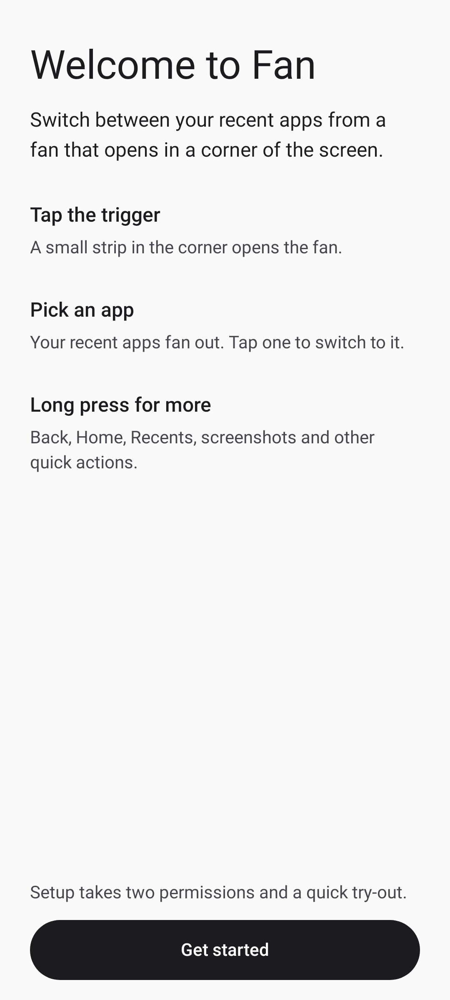
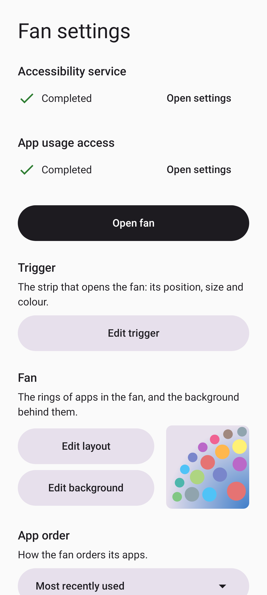
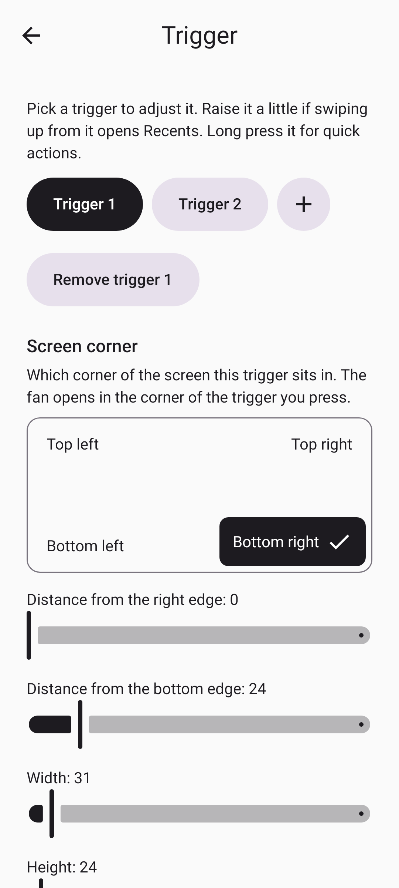
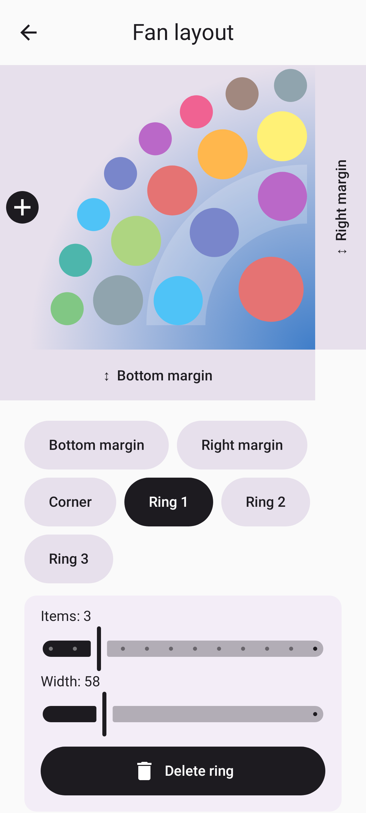
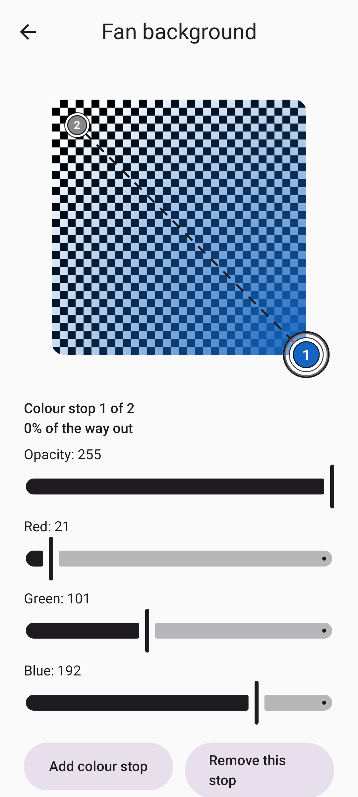
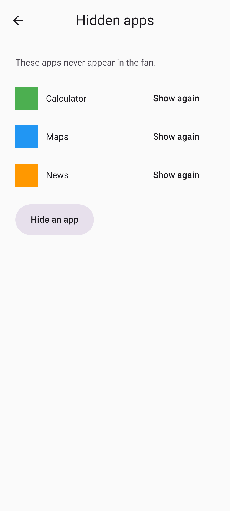

<!-- Generated from readme.yml by LukeNeedham/ci-workflows (docs/readme.md). Edit readme.yml, not this file. -->
<p align="center">
  
</p>

# Fan: Fast App Nav

Switch apps from anywhere, in one tap.

## Description

Fan puts a small trigger in a corner of your screen. Tap it to open a fan filled with your recent apps, pick one and
you're there.

- **Tap** the trigger to open the fan of recent apps (tap again to close it).
- **Double tap** it to jump straight back to the previous app.
- **Long press** it to open the same fan showing actions: Back, Home, Recents, Screenshot, Power menu, Flashlight,
  System settings and Fan settings.
- **Long press an app** in the fan to open its App Info page, where it can be force stopped.

You choose the screen corner, the trigger's size, position and colour, how many rings of apps the fan has, the
background gradient, and which apps never appear.

## Screenshots








## Getting started as a user

1. Download the latest APK from the [latest release](https://github.com/LukeNeedham/Android-Dock/releases/latest/download/Android-Dock.apk) and install it, or install a build from the AppHub app.
2. Open **Fan** once. It walks you through two permissions: the **accessibility service** (to see taps on the trigger) and **usage access** (to know which apps you used recently).
3. Customise the fan and trigger to your heart's content.
4. Tap the trigger in the corner of your screen to open your fan!
5. **After every update, switch accessibility back on** (Settings > Accessibility > Fan). Android turns it off on each install and it cannot be fixed from inside the app. See [Known limitations](docs/known-limitations.md).

Requires Android 6.0 (API 23) or newer.

## Getting started as a developer

Requirements: JDK 17 and the Android SDK (platform 37), for example through Android Studio.

```
git clone https://github.com/LukeNeedham/Android-Dock.git
cd Android-Dock
./gradlew assembleDebug    # the APK is in app/build/outputs/apk/debug/
./gradlew test             # unit tests
```

Every pull request is built by CI, which comments on it with a link to install the APK.

Like all my apps, it follows the shared architecture and conventions (single activity, Jetpack Compose, Navigation 3, MVVM with every page split into a `Page` and a `PageContent`, Koin): see [ci-workflows](https://github.com/LukeNeedham/ci-workflows/blob/main/docs/new-app.md).

## Documentation

| Doc | Covers |
|---|---|
| [Setup](docs/setup.md) | Installing, the two permissions, restricted settings, gesture navigation |
| [Using Fan](docs/using-fan.md) | The fan, the actions mode, double tap, how the recents list is chosen |
| [Customising](docs/customising.md) | Corner, trigger, fan layout, colours, hidden apps |
| [Known limitations](docs/known-limitations.md) | Accessibility reset on update, older Android versions, Google Play |
| [How it works](docs/how-it-works.md) | Architecture: the overlay, the sheet, the recents list |
| [Development](docs/development.md) | Building, CI, releases, project layout, the debug log |

## Contributing

Branch from `main`, make the change, and open a pull request. CI must be green before it is merged.

## License

All rights reserved. See [LICENSE](LICENSE).
